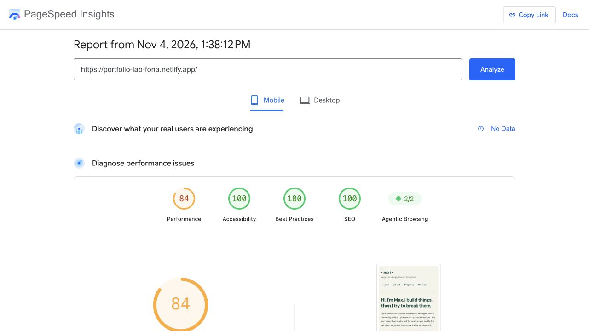
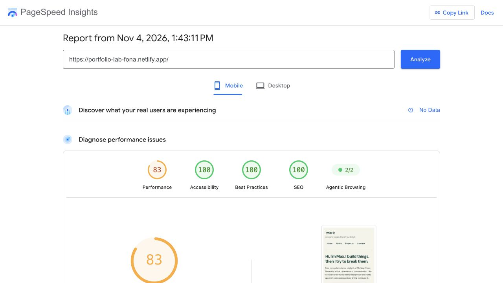
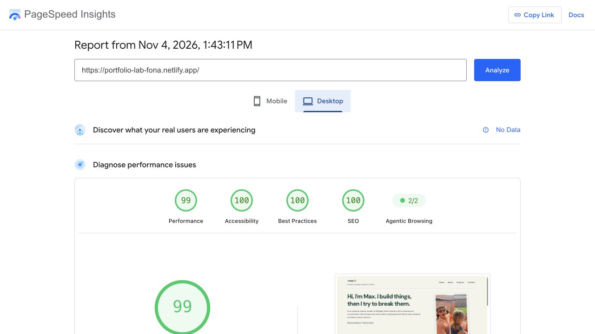

# Portfolio accessibility audit

Site: https://portfolio-lab-fona.netlify.app/  
Repository: https://github.com/maxfona20/portfolio-4.7  
Audit date: November 4, 2026

## PageSpeed Insights findings

The initial mobile PageSpeed Insights audit scored **100/100 Accessibility**. It reported **26 passed accessibility audits**, **37 not applicable**, and **10 additional manual checks**. No automated accessibility failures were reported. The performance score of 84 is a separate category and is not an accessibility failure.

[Initial mobile report](https://pagespeed.web.dev/analysis/https-portfolio-lab-fona-netlify-app/vioqvnkway?form_factor=mobile)

A 100 automated score does not establish full accessibility. Keyboard focus, reading order, form interaction, and usability also require manual review.

## Existing features retained

- English document language and a descriptive page title.
- A skip link before the navigation, semantic header/navigation/main/footer landmarks, and hierarchical headings.
- Descriptive portrait alternative text.
- Explicit labels for name, email, topic, and message; native form controls and required-field validation.
- Logical source order preserved across responsive layouts.
- Underlined content links and a dark-green text palette with adequate text contrast in the automated audit.

## Findings and improvements

| Finding | Change | Verification |
| --- | --- | --- |
| The skip link already works, but main and section destinations have no explicit focusability contract. | Added `tabindex="-1"` to main and the four section destinations. They can receive anchor focus without adding extra Tab stops. | Check that Enter moves to the target and the next Tab continues with its content. |
| The existing focus outline can be reinforced against adjacent surfaces. | Retained the 3px outline and added a contrasting white separation ring, plus visible outlines on anchor destinations. Added a forced-colors focus rule. | Inspect focused navigation, content links, and form controls. |
| Required form fields are enforced by the browser but not identified in the visible labels. | Added “required” to the three required labels and a visible form instruction associated with `aria-describedby`. | Confirm labels and instructions are exposed; native validation remains enabled. |
| Four external links open new tabs without an accessible advance warning. | Added visually hidden “opens in a new tab” text to each. | Inspect accessible link names and retain `rel="noopener noreferrer"`. |

## Manual keyboard test record

The initial deployed site was tested using actual keyboard input: the first Tab focused “Skip to main content”; Enter activated it; the next Tab reached “See my projects”, bypassing the primary navigation. This confirmed the existing skip-link behavior before changes.

Post-change checks and deployment evidence are recorded below after verification. The test intentionally does not submit a contact message or open an email application.

## Keyboard recording

See [KEYBOARD-WALKTHROUGH.md](KEYBOARD-WALKTHROUGH.md) for a 90-second route and narration. Record yourself navigating the published site using only the keyboard. The recording is a separate deliverable; this document does not claim that it has been recorded.

### Post-change local keyboard verification

Verified in Chromium with real keyboard events on November 4, 2026:

- First Tab focuses the skip link; computed focus outline is 3px.
- Enter focuses `main-content`; the next Tab reaches “See my projects”.
- Enter on that link focuses the Projects section and updates the fragment to `#projects`.
- The next Tab reaches the project training-resource link, rather than restarting navigation.
- Tab reaches the contact links, then Name, Email, Topic, Message, and Send message in source order.
- Name, email, and message accept keyboard entry. Space, Down, and Enter select “Project collaboration” in the native Topic menu.
- Shift+Tab moves backward through controls without trapping focus.
- Tab from Send message reaches Back to top; Enter focuses the Home section and changes the fragment to `#home`.
- No form submission was made.

## Published verification and final results

The site changes were committed as `1e95718` and pushed to `main`. The public Netlify site was then checked directly: the deployed HTML contains the new `tabindex="-1"` focus targets and required-field guidance.

PageSpeed Insights was rerun against that published version on November 4, 2026 at 1:43 PM EST, using Lighthouse 13.6.0:

| Profile | Accessibility | Passed | Not applicable | Manual checks |
| --- | --- | --- | --- | --- |
| Mobile | **100/100** | 27 | 36 | 10 |
| Desktop | **100/100** | 27 | 36 | 10 |

[Final mobile report](https://pagespeed.web.dev/analysis/https-portfolio-lab-fona-netlify-app/c87lirqq0s?form_factor=mobile) · [Final desktop report](https://pagespeed.web.dev/analysis/https-portfolio-lab-fona-netlify-app/c87lirqq0s?form_factor=desktop)

## Submission checklist

- [x] Audit the published portfolio with PageSpeed Insights.
- [x] Place ACCESSIBILITY.md at the repository root.
- [x] Improve keyboard navigation and document the changes.
- [x] Verify 100 accessibility on the published site and save screenshots.
- [x] Commit and push the site improvements; verify Netlify published them.
- [x] Prepare a timed keyboard walkthrough and narration.
- [ ] Record and submit the student's own 1–2 minute keyboard-only walkthrough with narration or key captions.
